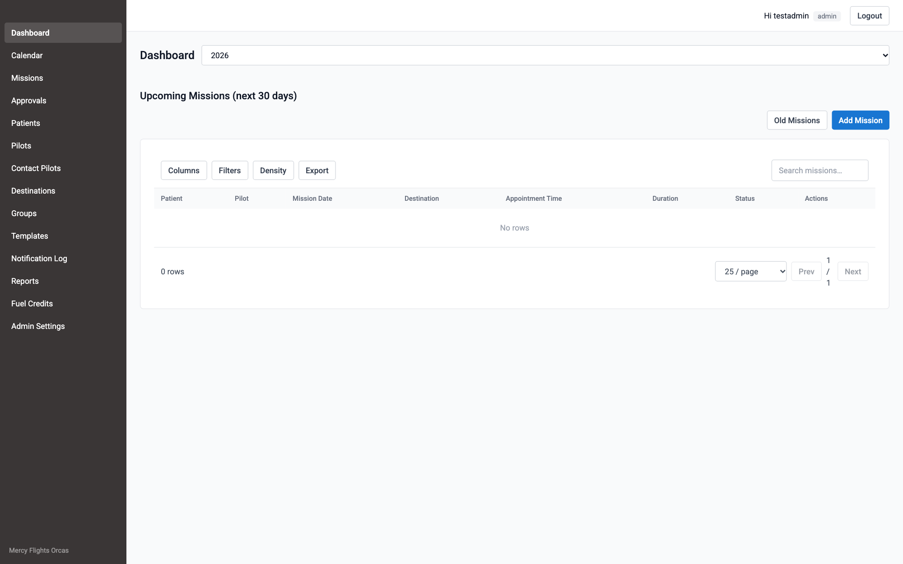
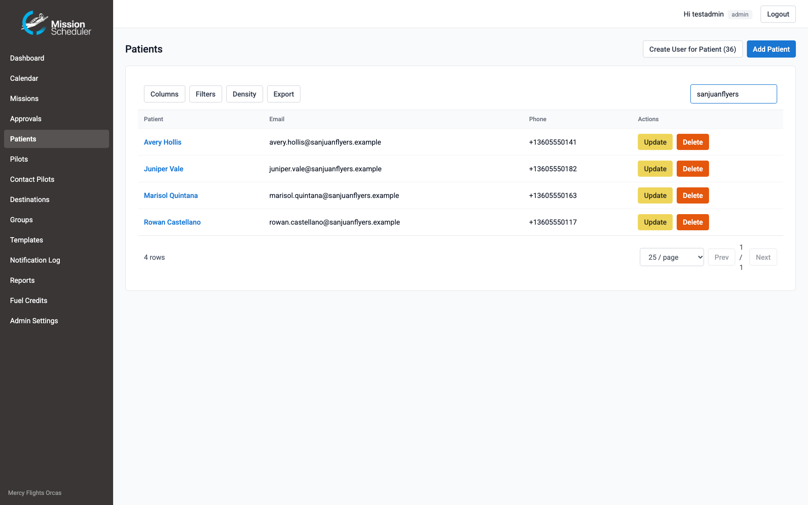
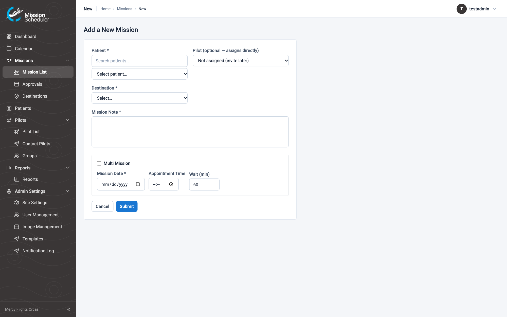
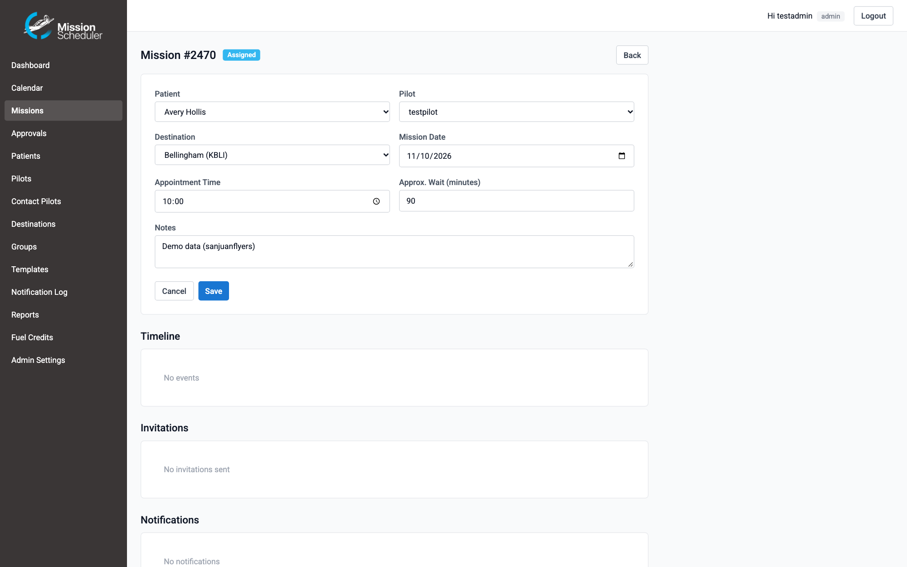
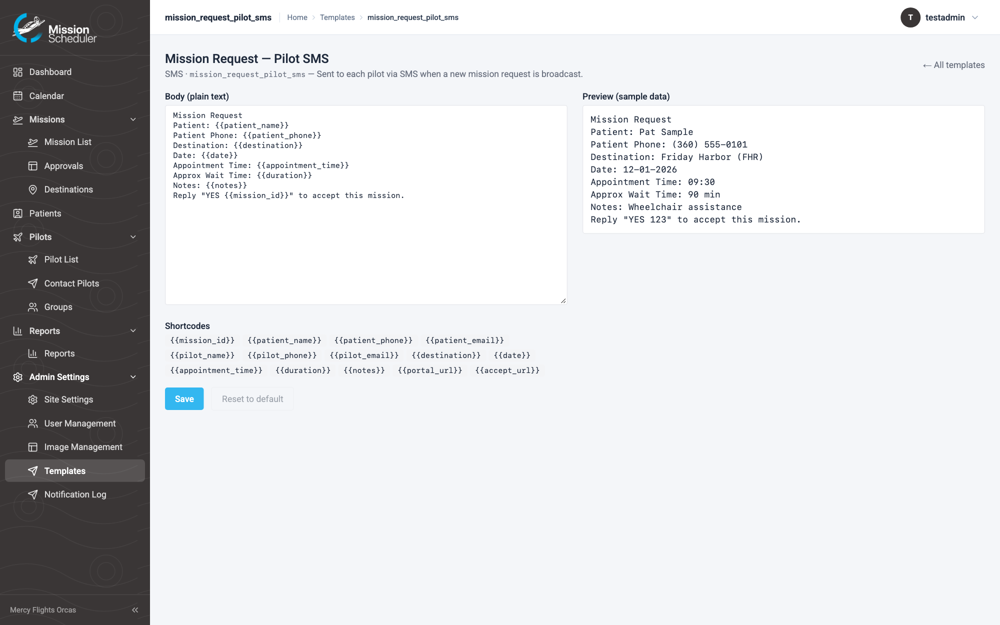
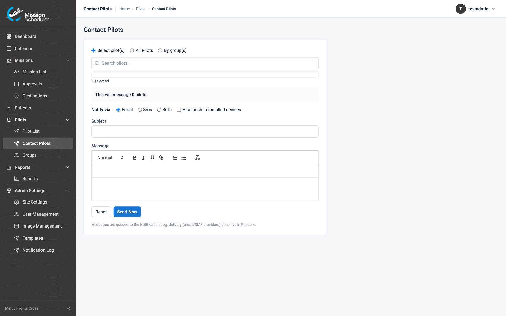

# Coordinator Guide — Mission Scheduler

For the scheduling coordinator (admin role). Everything below happens at
your organization’s Mission Scheduler address (hosted for you — nothing to install) after signing in. Screenshots show fictional
demo data.

## Signing in

Use your email and password. First time (or forgotten password): **Forgot Password?**
on the login page emails you a reset link. The app also works great on your phone —
see the [Pilot Guide](PILOT-GUIDE.md) for install steps; admins get the same app with
more menus.

Your dashboard shows the year's totals and the last 30 days of missions. The sidebar is
your map: Missions, Calendar, Patients, Pilots, Destinations, Groups, Reports,
Templates, Notifications, Admin Settings.

## Add a passenger (patient)

**Patients → Add Patient.** Name is required; add email/phone and tick how they want to
be contacted (email / SMS) — those switches control which notifications they get. A
patient with an email can be given a login (**Create login** on their row) so they can
see their own upcoming missions.

## Post a mission

**Missions → New Mission** (or the + button). Pick the passenger, destination, date and
appointment time, duration, and any notes. Multiple dates at once create one mission per
date.

When you save, the app asks whether to **send mission requests now or later**:

- **Now** — pilots in the audience you chose (all pilots or a group) get the Mission
  Request email/SMS/push with a one-tap accept link. First to accept gets it.
- **Later** — the mission sits as *open*; send invites from the mission page when ready.

## Invite, assign, and manage a mission

Open any mission to see its timeline, invites, and notification history.

**Inviting pilots** — the Invite dialog has three modes:

- **Select pilot(s)**: search by name, narrow with capability chips (aircraft, MVFR,
  night, short-notice), and tick exactly who you want.
- **All pilots**: every active pilot at once.
- **By group(s)**: pick one or more pilot groups — overlapping members are only
  invited once.

Before anything sends, the dialog previews "This will invite N pilots" with an
expandable list of exactly who. Only the **assigned pilot** and **inactive pilots**
are left out (the preview says so, e.g. "Not included: 1 assigned · 2 inactive").

**Re-inviting**: a pilot who already has a pending invite stays selectable — their
chip shows when they were invited (e.g. "Invited 11/7 12:01"). Selecting them again
simply re-sends the Mission Request and records a new invitation row marked
**resent**. Each row of the mission's Invitations table also has its own **Resend**
button for a one-click nudge.

- **Assign** a pilot directly (or change pilots) — both pilot and passenger are notified.
- A pilot who accepts gets a confirmation; everyone else's invite closes.
- If a pilot **relinquishes**, you're notified and the mission reopens.
- **Cancel** asks for a reason, which goes into the notifications.

## Approve a pilot's offered mission

Pilots can post missions for themselves without approval. When a pilot wants to **offer
a mission to other pilots**, it lands in **Pending Approvals** (sidebar badge). Approve
to release the standard invites, or decline with a note — the pilot is notified either
way.

## Edit a message template

**Templates** lists every email/SMS/push text the system sends. Click one to edit:
shortcode chips (like `{{mission_date}}`) insert live values, the preview shows it with
sample data, and **Reset to default** undoes your changes.

## Contact pilots

**Pilots → Contact Pilots** sends a one-off email/SMS to all pilots, a group, or a
hand-picked set — it uses the same delivery log as everything else.

## Reports

**Reports** shows per-pilot mission totals (filter by year, export CSV) and a
date-range **mission history CSV**.

## Manage users

**Admin Settings → User Management**: every login as a card.

- **Add User** (admin / pilot / patient) — a welcome email is queued; they set their own
  password via Forgot Password.
- **Resend activation** — emails/texts a fresh set-your-password link (used at launch;
  skipped automatically once the person has signed in).
- **Change Password** — set one directly, e.g. over the phone.
- **Delete** — removes the login (refused while a pilot still has upcoming assigned
  missions). The pilot/patient record stays.

## Branding & settings

- **Admin Settings → Image Management**: logo, login images, and the favicon (which also
  becomes the app icon on phones). Changes apply immediately.
- **Admin Settings → Site Settings**: colors, timezone, calendar animation, and the
  email sender identity (name, reply-to).

## When something doesn't send

**Notifications** shows every email/SMS/push with its status. Failed rows show the
provider error and have a **Retry** button. If you see a burst of failures, the platform
operator is alerted automatically within the hour.
