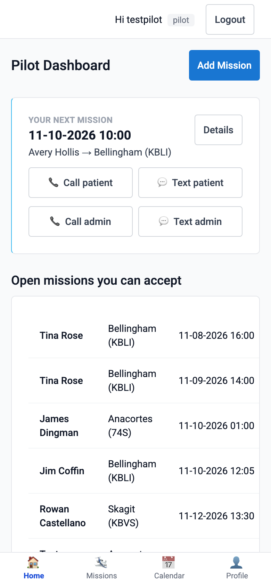

# Pilot Guide — Mission Scheduler

One page: everything a pilot does, from their phone.

## 1. Put it on your phone

- **iPhone**: open **your organization’s address** in **Safari** → tap **Share** (the
  square with the arrow) → **Add to Home Screen** → **Add**. Open it from your home
  screen and sign in once. (Requires iOS 16.4+ for notifications.)
- **Android**: open the same address in Chrome → tap **Install app** when offered (or
  menu ⋮ → *Add to Home screen*).
- No password yet? Use the link from your welcome text/email, or **Forgot Password?**
  on the login page.

## 2. Turn on notifications

After installing, the app offers push notifications once — tap **Enable**. You can
change it any time in **Profile**: the device toggle, and whether you want
**Push + SMS**, push only, or SMS only.

## 3. Accept a mission

When a mission needs a pilot you'll get a push/SMS/email:

- **Push**: tap **Accept** right on the notification, or open it and confirm.
- **SMS**: reply **YES 123** (the mission number in the text).
- **In the app**: open missions show on your dashboard with an **Accept** button.

First pilot to accept gets the mission; you'll get a confirmation with a calendar
invite attached. The mission card has tap-to-call/text for the passenger and the
coordinator, and an **Open in Maps** link.

## 4. Can't fly after all?

Open the mission → **Relinquish** (with confirmation). The coordinator is notified and
the mission reopens for others. Please also call the coordinator if it's short notice.

## 5. Add your own mission

**Missions → New Mission.** Flying it yourself? It's assigned to you immediately — no
approval needed. Want to **offer it to other pilots**? Choose the audience (all pilots
or a group); the coordinator approves it before invites go out, and you'll be notified
of the decision.

You can also add a new passenger yourself (Patients → Add Patient).

## 6. Fuel credits

Every mission flown earns **+10 gallons** (added automatically overnight). Your balance
is on your dashboard and Profile; the coordinator records your refuels at the pump.
